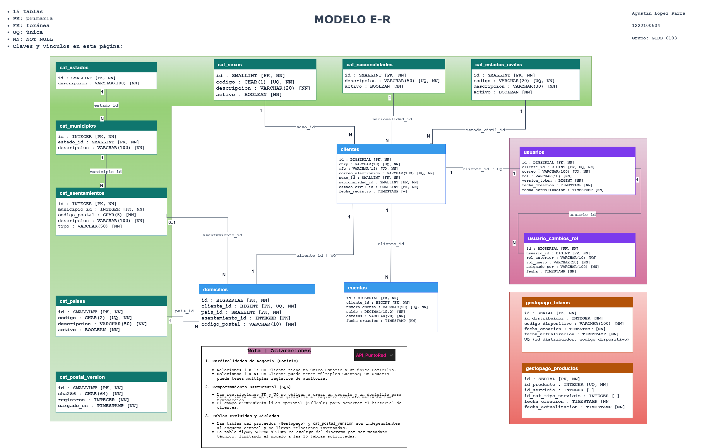
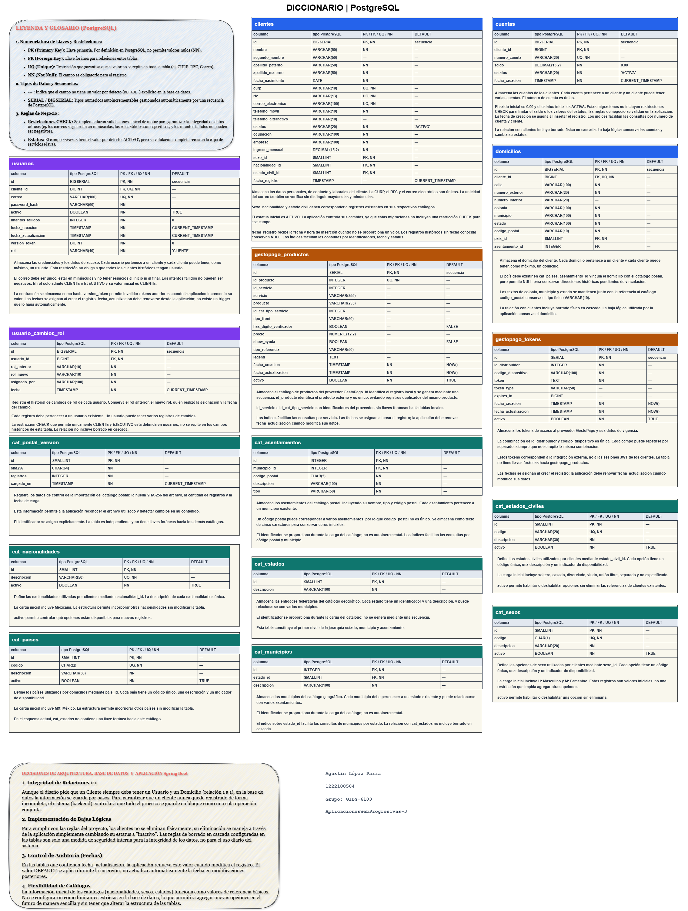

# Ambientar-Proyecto

> **Rama feature/Validaciones:** la adaptación de contrato y V9 se describen en [Entrega de validaciones](docs/validaciones-entrega.md). Estos cambios locales no están desplegados en Render.

API REST para registrar y administrar clientes personas físicas, sus usuarios y cuentas. Incluye catálogos mexicanos, autenticación, permisos por rol e integración con el catálogo de productos GestoPago.

**API desplegada:** https://ambientar-proyecto.onrender.com

**Swagger:** [Abrir documentación interactiva y ejecutar peticiones](https://ambientar-proyecto.onrender.com/swagger-ui/index.html).

Este README reúne el documento técnico de la solución. La revisión de los endpoints se realiza desde Swagger, siguiendo el orden de la sección API REST y consultas.

**Accesos directos:**

- [Diagrama entidad–relación](#diagrama-entidadrelación), [PDF](docs/diagramas/V3%20DIAGRAMA%20E%20R%20Integracion%20de%20clientes.pdf) y [archivo editable](docs/diagramas/modelo-er-v8.drawio.xml).
- [Script único de creación de base de datos](scripts/crear-base-datos.sql).
- [Código fuente Java](src/main/java/) y [recursos y migraciones](src/main/resources/).
- [Reglas de negocio](#solución-java-y-reglas-de-negocio) y [secuencia de endpoints](#api-rest-y-consultas).
- [Matriz de pruebas funcionales](https://docs.google.com/spreadsheets/d/1wuJ65P2yGV9EE4FCUEvcD3ppr8lwz2MxvaRizK-WxH0/edit).
- [Resultados de la suite Java](docs/evidencias/suite-java.json) y [plan y resultados de JMeter](docs/jmeter-plan-resultados.md).

## Ejecución local en Linux

Desde la raíz del proyecto, configurar la conexión y ejecutar:

```bash
export PGHOST=localhost PGPORT=5432 PGUSER=postgres
read -rsp 'Contraseña de PostgreSQL: ' PGPASSWORD; printf '\n'
export PGPASSWORD
sh scripts/crear-base-datos.sh revision_hasani
sh scripts/iniciar-api.sh revision_hasani
```

La creación ejecuta el SQL único y carga automáticamente `datos/CPdescargatxt.zip`, incluido en el proyecto. V1–V8 se conservan como historial de migraciones; no se ejecutan manualmente por separado. El catálogo contiene 159,340 asentamientos, 2,478 municipios y 32 estados, con [origen y huella SHA-256](datos/README.md) documentados. Para reiniciar una base ya creada, ejecutar únicamente el iniciador de la API.

Swagger local: `http://localhost:8081/swagger-ui/index.html`. El perfil local de revisión prueba clientes y cuentas; la integración externa se revisa en el entorno desplegado. Las mediciones JMeter entregadas corresponden al entorno local.

## Diagrama entidad–relación



<details>
<summary>Ver el diccionario completo de las 15 tablas</summary>



</details>

El modelo contiene **15 tablas de aplicación**; `flyway_schema_history` es una tabla adicional de infraestructura. Clientes se relaciona con domicilio y usuario mediante FK `NOT NULL` y `UNIQUE`, y con cuentas mediante una FK sin `UNIQUE`. El esquema permite 0..1 domicilio/usuario y 0..N cuentas por cliente; el servicio de registro garantiza la creación conjunta de las filas del alta nueva.

Estados → municipios → asentamientos forman la jerarquía postal. Un CP puede tener varias colonias. El domicilio selecciona un asentamiento compatible con su CP. La FK postal conserva nulabilidad para domicilios históricos sin correspondencia única; los registros nuevos requieren el asentamiento.

`usuario_cambios_rol` registra las asignaciones de rol. `gestopago_tokens`, `gestopago_productos` y `cat_postal_version` conservan su independencia física; no se dibujan FKs que no existen en SQL. La información laboral está integrada en la tabla `clientes`.

### Tipos de datos, almacenamiento e integridad

| Dato | Tipo implementado | Motivo y límite |
|---|---|---|
| IDs personales y claves de referencia | `BIGSERIAL` / `BIGINT` | Identidad generada y referencias del mismo tipo; enteros de 8 bytes |
| Catálogos personales y estados | `SMALLINT` | Claves de rango pequeño; enteros de 2 bytes |
| Municipios y asentamientos | `INTEGER` | Claves compuestas del catálogo dentro de su rango; enteros de 4 bytes |
| Nacimiento | `DATE` | Fecha sin hora |
| Fechas de registro y auditoría | `TIMESTAMP` | Fecha y hora; históricos desconocidos pueden conservar NULL |
| CURP, RFC y correo | `VARCHAR(18)`, `VARCHAR(13)`, `VARCHAR(100)` | Límites según contrato; restricciones de unicidad |
| Teléfono y cuenta | `VARCHAR(10)` y `VARCHAR(20)` | Identificadores textuales que conservan ceros iniciales |
| CP | `CHAR(5)` en catálogo; `VARCHAR(10)` heredado en domicilio | API de cinco dígitos; no se trata como cantidad numérica |
| Saldo e ingreso | `DECIMAL(15,2)` y `BigDecimal` en Java | Importes exactos con dos decimales |
| Estado habilitado | `BOOLEAN` | Valor lógico de catálogo/usuario/producto |
| Contraseña | `VARCHAR(60)` | Hash BCrypt; no se almacena la contraseña en texto |

Los tamaños de enteros corresponden al valor, sin incluir cabecera de fila ni índices. `VARCHAR(n)` establece un máximo de caracteres, no reserva siempre `n` bytes. `CHAR(n)` utiliza relleno y no aporta una ventaja general de rendimiento. La precisión de `NUMERIC/DECIMAL` tampoco implica almacenamiento fijo de todos sus dígitos. Fuentes: [tipos numéricos PostgreSQL 17](https://www.postgresql.org/docs/17/datatype-numeric.html) y [tipos de caracteres](https://www.postgresql.org/docs/17/datatype-character.html).

Las FKs, `NOT NULL`, `UNIQUE` y los CHECK de rol/intentos preservan las restricciones físicas correspondientes. Las reglas de edad, contraseña, ingreso positivo y opciones habilitadas se implementan en Java; no se atribuyen a un CHECK inexistente. El correo se normaliza y su unicidad se comprueba sin distinguir mayúsculas.

Se usan índices para relaciones, identificadores, CP, estatus y fecha. V3 también conserva índices explícitos sobre algunas columnas con `UNIQUE`; esos índices pueden resultar redundantes y deben revisarse mediante una migración posterior, sin modificar el SQL ya aplicado. Las consultas generales se paginan para limitar filas transferidas; no se afirma una medición de memoria total de la aplicación.

## Solución Java y reglas de negocio

La aplicación administra el registro de una persona y mantiene relacionados sus datos personales, domicilio, cuenta y usuario de acceso. Java comprueba la información recibida antes de guardarla en PostgreSQL. Los controladores reciben las solicitudes, los servicios aplican las reglas y los repositorios consultan o guardan los registros.

### Registro del cliente y creación de cuenta

El registro sólo se acepta si la persona es mayor de edad y cumple las validaciones de identidad, contacto, domicilio, ingreso y contraseña. El nombre y los apellidos admiten letras y espacios. La fecha de nacimiento debe ser válida y anterior al día actual. CURP, RFC y correo no pueden estar registrados previamente; el correo se compara sin distinguir mayúsculas y minúsculas.

El domicilio debe seleccionar un asentamiento existente que pertenezca al código postal indicado. Las opciones personales y el país deben corresponder a valores habilitados del catálogo. El ingreso mensual debe ser mayor que cero y admitir como máximo dos decimales. Estas comprobaciones se realizan en el servidor, independientemente de la herramienta utilizada para enviar la petición.

Cuando el alta es válida, se crean juntos el cliente, su domicilio, una cuenta activa con saldo inicial de cero y un usuario con rol CLIENTE. La aplicación genera el número de cuenta de veinte dígitos. Si alguno de estos registros no puede guardarse, se cancela toda el alta para evitar información incompleta. El número generado es un identificador interno de cuenta y no una CLABE.

### Acceso y protección de la información

La contraseña se guarda mediante BCrypt; las consultas no devuelven la contraseña ni su hash. Para iniciar sesión, el usuario debe estar activo y proporcionar sus credenciales correctas. Tres intentos incorrectos consecutivos bloquean su acceso. Una sesión correcta entrega un JWT con vigencia limitada, que se utiliza para autorizar las peticiones protegidas.

El rol CLIENTE permite consultar y administrar exclusivamente los datos propios. El rol EJECUTIVO permite las consultas generales y la administración de clientes contemplada por la API. El registro público siempre crea un CLIENTE; la asignación de EJECUTIVO se realiza mediante el [procedimiento administrativo auditado](scripts/asignar-ejecutivo.sql).

En las consultas por ID, la aplicación verifica quién inició sesión y si tiene permiso sobre el registro solicitado. Cambiar el identificador en una URL no concede acceso a información ajena. Para un CLIENTE, un registro ajeno responde igual que uno inexistente, sin revelar su existencia. El cambio de contraseña sólo lo puede realizar el propietario, incluso si otro usuario tiene rol EJECUTIVO.

### Actualización, contraseña y baja

La actualización conserva la CURP, el RFC, la cuenta y la fecha original de registro. Si cambia el correo, se mantiene la correspondencia entre el cliente y su usuario de acceso. El cambio de contraseña exige confirmar la contraseña actual y validar la nueva; después invalida los tokens anteriores y obliga a iniciar sesión nuevamente.

La baja es lógica: conserva el historial, marca al cliente y sus cuentas como inactivos y desactiva el usuario. Los tokens anteriores dejan de dar acceso. La operación se deja al final de la revisión porque modifica la disponibilidad del perfil.

### Validación y manejo de errores

Las respuestas de error usan los campos `timestamp`, `status`, `codigo`, `mensaje`, `path` y `errores`. Cuando una entrada no cumple una regla, se indica el campo afectado y un mensaje descriptivo. Los manejadores globales centralizan los errores de validación, negocio e integración; la seguridad devuelve el mismo formato para rechazos de acceso. Los errores inesperados no muestran trazas ni credenciales.

La contraseña nueva requiere al menos ocho caracteres, mayúscula, minúscula, número y símbolo; no admite espacios ni caracteres de control y está limitada a 72 bytes UTF-8. Los IDs deben ser enteros positivos. El servidor rechaza tipos JSON incompatibles con los campos definidos. Las validaciones de CURP y RFC comprueban formato, coherencia y unicidad, sin certificar su autenticidad ante una autoridad.

### Productos GestoPago

La aplicación obtiene el catálogo del proveedor mediante sus credenciales de integración. La sincronización guarda o actualiza los productos por su identificador externo, conserva su identidad local y evita insertar duplicados al repetir la operación. Redis mantiene la caché del catálogo; una sincronización confirmada invalida esa caché. El JWT del usuario y el token del proveedor son independientes.

### API REST y consultas

El contrato de esta rama recibe IDs y filtros por body. Consulta la [tabla de rutas, secuencia y comandos de comprobación](docs/validaciones-entrega.md#contrato-por-body). Inicia sesión con POST /auth/login y autoriza el JWT en Swagger antes de las consultas protegidas. Las rutas antiguas con IDs en la URL ya no están disponibles en esta rama.

## Pruebas y resultados

La API en Render arrancó desde una base vacía, aplicó las ocho migraciones y cargó 159,340 asentamientos, 2,478 municipios y 32 estados. Se comprobaron respuestas **200** en sexos y código postal `37907`, además del alta **201** y la denegación **403** del listado general a un CLIENTE.

- Suite Java histórica: **67 pruebas aprobadas**, cero fallos y cero omisiones. [Resultado](docs/evidencias/suite-java.json).
- Revisión de usuarios del 10 de octubre de 2026: **42 pruebas de integración aprobadas**, incluyendo acceso propio, permisos por ID, contraseña y revocación de sesión. Esta ejecución verifica las correcciones localmente; no sustituye una comprobación posterior del despliegue.
- [Matriz funcional](https://docs.google.com/spreadsheets/d/1wuJ65P2yGV9EE4FCUEvcD3ppr8lwz2MxvaRizK-WxH0/edit): la ejecución histórica del 9 de octubre registró **96 casos aprobados, 7 fallidos y 2 bloqueados**.
- [Plan y resultados JMeter](docs/jmeter-plan-resultados.md), [muestras y reportes](tests/jmeter/resultados/20261009-120812/): login y consultas QA locales durante 60 segundos por nivel.

| Usuarios JMeter | Muestras | Errores | Media ms | P95 ms | Máximo ms |
|---:|---:|---:|---:|---:|---:|
| 1 | 90 | 0 | 100.41 | 154 | 2606 |
| 10 | 924 | 0 | 73.86 | 170 | 1638 |
| 25 | 2029 | 0 | 140.24 | 417 | 2845 |

Las **3,043 muestras** comprobaron respuesta HTTP y contenido, con pausas entre consultas. Estas cifras corresponden al equipo local documentado; no acreditan la misma capacidad en Render ni una carga máxima de producción.

Las incidencias históricas corresponden a altas repetidas, preparación de datos para duplicados y consultas del catálogo externo. Se mantienen identificadas en la matriz. No se presentan como pruebas aprobadas sin una nueva ejecución.

## Archivos de entrega

El repositorio reúne el código fuente, el script SQL único, las migraciones V1–V8, el ZIP postal, los diagramas y las evidencias. Este README es el documento técnico principal. El paquete opcional se genera en Linux con:

```bash
python3 scripts/empaquetar-entrega.py --incluir-jar
```

El paquete conserva las rutas del proyecto y un manifiesto SHA-256. Excluye configuraciones privadas, cachés y archivos del IDE.
